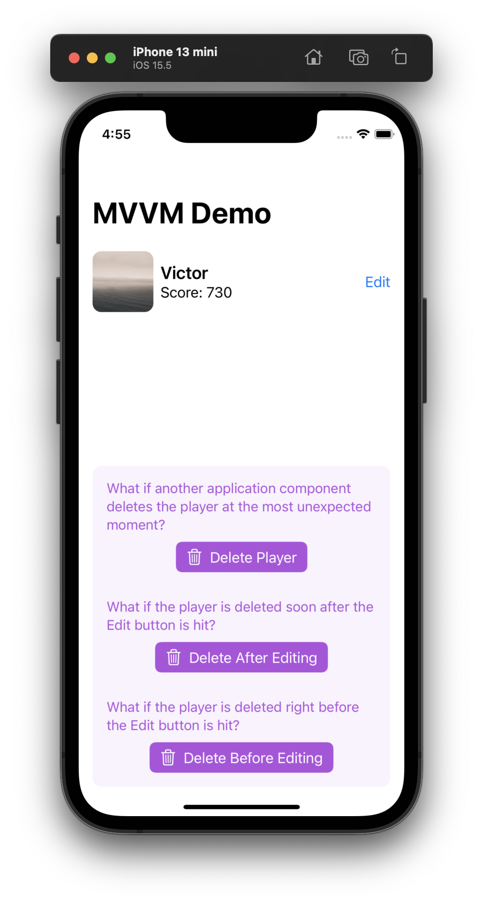

MVVM Demo Application
=====================

This demo application shows how the [`@EnvironmentStateObject`](https://swiftpackageindex.com/groue/grdbquery/documentation/grdbquery/environmentstateobject) property wrapper helps an [MVVM](https://swiftpackageindex.com/groue/grdbquery/documentation/grdbquery/mvvm) SwiftUI application access a database. Mainly:

- The [main view](MVVMDemo/Views/AppView/AppView.swift) of the app is kept up-to-date with the information stored in the database.
- [A sheet](MVVMDemo/Views/PlayerEditorView/PlayerEditorView.swift) makes sure it gets dismissed as soon as the value it needs no longer exists in the database.

It is also an opportunity to explore a few practices:

- _The database is the single source of truth._ All views read from the database, and communicate through the database. This is not a general rule that fits all applications, but it fits this demo app well.
- _The application is robust against surprising database changes._ Surprises usually happen as your application evolves, is extended with new features, and becomes more complex. In this demo application, all the purple buttons trigger scenarios that could happen in real life. How do we make the app robust in all those scenarios? 
- _The application accesses the database via the `Players` Swift Package._
